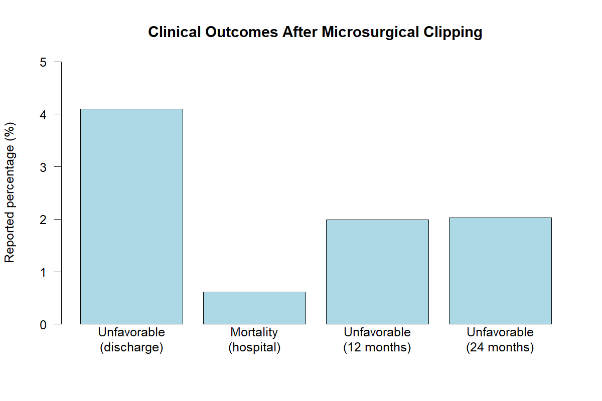

# health-statistics-portfolio
Beginner statistics portfolio exploring published clinical outcomes using R.
# Health Statistics Portfolio

## Project Overview

This project explores published clinical outcome statistics following microsurgical clipping of unruptured intracranial aneurysms. It uses descriptive statistical analysis in R to summarize selected clinical outcomes reported in a published research study.

This is a beginner-level statistics portfolio project developed to practice data handling, descriptive analysis, and data visualization using R and RStudio.

## Objectives

- Summarize selected clinical outcomes reported in the research paper.
- Present outcome percentages in a clear and interpretable format.
- Practice basic data analysis and visualization using R.
- Develop foundational skills for future projects in health statistics and data analysis.

## Data Source

The data are based on the following published study:

Drexler et al. (2024). *Global Outcomes for Microsurgical Clipping of Unruptured Intracranial Aneurysms: A Benchmark Analysis of 2245 Cases.*

[Read the research paper on PubMed Central](https://pmc.ncbi.nlm.nih.gov/articles/PMC10766286/)

The project uses selected aggregate statistics reported in the publication, not individual patient-level records.

## Key Findings

The selected outcomes reported in the study include:

- **Unfavorable neurological outcome at discharge:** 4.10%
- **In-hospital mortality:** 0.62%
- **Unfavorable neurological outcome at 12 months:** 1.99%
- **Unfavorable neurological outcome at 24 months:** 2.03%

These percentages describe the outcomes reported in the source study. They should be interpreted within the study's population and methodology and should not be assumed to represent all patients or clinical settings.

## Methods and Tools

- **Programming language:** R
- **Software:** RStudio
- **Methods:** Descriptive statistics and data visualization
- **Data format:** CSV
- **Visualization:** Bar chart

## Limitations

This project is an exploratory descriptive analysis based on selected published aggregate statistics. It does not use individual patient-level data, establish causal relationships, or independently validate the original study's findings.

The results should be understood in the context of the original research rather than as general predictions of clinical outcomes.

## Author

A first-semester Statistics student at Universitas Terbuka, Indonesia, learning R, statistical analysis, and data visualization through independent projects.

## Visualization

## What I Learned

Through this project, I practiced:

- Importing and organizing data in CSV format.
- Selecting observations using conditions in R.
- Summarizing published clinical outcome percentages.
- Creating a bar chart to communicate statistical information.
- Documenting an analysis and its limitations.

This project represents my first steps in applying statistics to published health research and developing reproducible data analysis skills.

